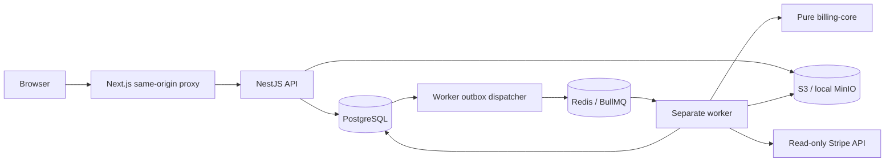

# Architecture

The web application proxies `/api/v1/*` to NestJS on the server, forwarding cookies, CSRF, origin, and the selected organization header. Browser storage contains only the selected organization ID. Authentication tokens are HttpOnly cookies.

Domain services share a modular monolith and transaction utilities; worker entry points call the same domain services. The implementation uses TypeORM's DataSource/EntityManager and explicit parameterized SQL for tenant-scoped bulk operations. Identity uses EntitySchema repositories. Domain controllers are assembled in a shared DomainModule rather than separate modules per table. This keeps bulk ingestion and the transaction/outbox boundary explicit without repository indirection.

Imports stream through disk-backed multipart uploads and S3 streams; the parser retains at most 1,000 rows per batch. A transaction serializes source imports within an organization. Immutable raw rows retain acceptance/rejection/duplicate status; logical event uniqueness is `(organization_id, source_event_id)`. A batch-to-event reference table makes a repeated import usable as an audit source while retaining only one logical event.

The API snapshots source events, mapping versions, prices, provider evidence, configuration, and algorithm version into each run. Financial computation runs only in the worker. Capturing a large input can still take seconds and holds a repeatable-read transaction; splitting source snapshots into content-addressed immutable chunks is a future scaling improvement. Run result evidence currently includes source event IDs; detail preview caps source records at 100.

An outbox row and its resource are committed together. BullMQ uses the outbox UUID as job ID, three attempts, exponential backoff, and resource-level idempotency. Queue names include the database name to isolate local/test environments. Completed imports and runs become no-ops on retries; finding uniqueness is `(run_id, fingerprint)`. Failed operations appear in Settings and can be retried. Redis AOF must be durable; recovering an externally erased queue for already-ENQUEUED outbox rows requires an operator recovery procedure.

Dashboard financial totals aggregate **one result per component from the latest completed run**, avoiding double-counting when a component produces multiple findings or audits are rerun. Totals are grouped by currency. Review counts and exception type charts cover retained finding history, and the UI labels that scope.

Pinned dependency choices were verified against registry peer/engine metadata. NestJS 12's ESM packages are consumed using Node 24's supported require(ESM), with TypeScript Node20 module semantics. Shared packages build first through Turborepo. The server build creates local node_modules links beneath `dist/apps` so compiled entry points resolve their workspace dependencies on Windows and Linux.
